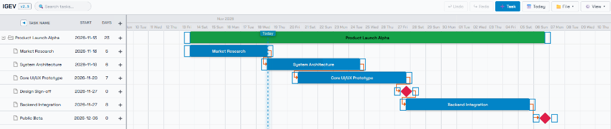
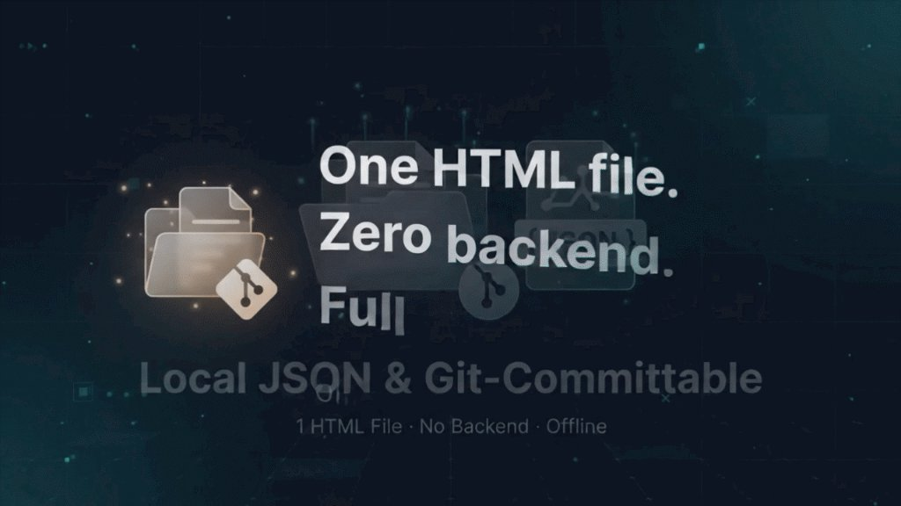
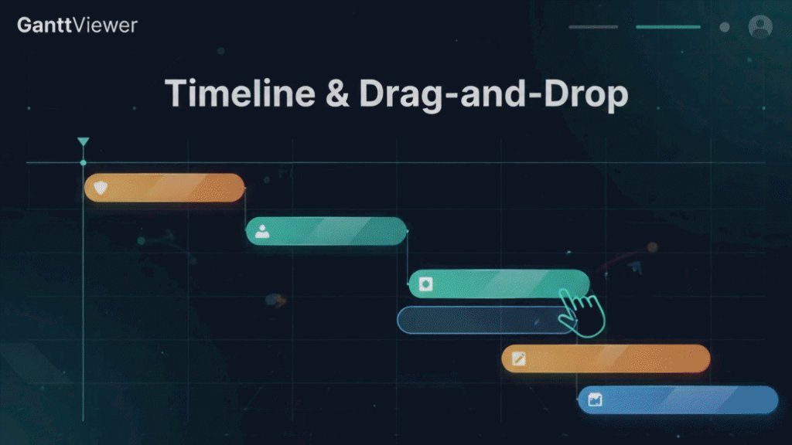
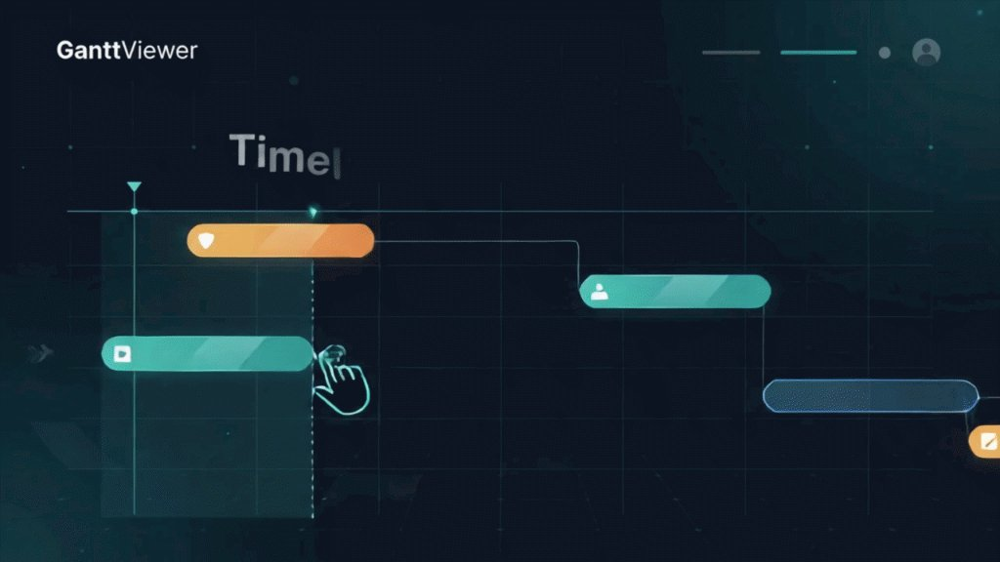
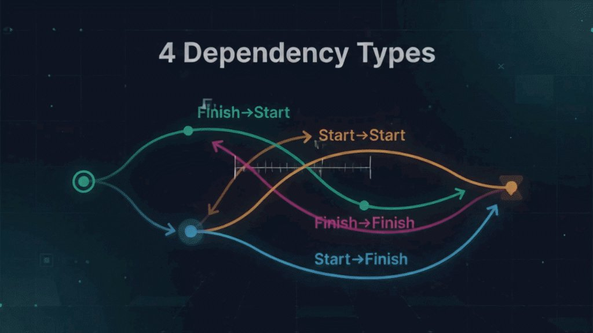

# IGEV — Intuitive Gantt Editor & Viewer

<p align="center">
  
</p>

<p align="center">
  <strong>The lightweight, zero-backend Gantt chart editor and roadmap planner that lives in a single HTML file.</strong><br>
  <em>Drag-and-drop scheduling, 4 dependency types, 100% offline-ready, and Git-committable.</em>
</p>

<p align="center">
  
  
  
  
  
</p>

---

## 🎯 Who is IGEV for? (Target Audience)

Traditional project management tools (Jira, MS Project, Monday, Asana) are often bloated, expensive, and lock your project data inside proprietary clouds. **IGEV** is designed for anyone who wants a fast, visual, and self-contained roadmap solution without the SaaS overhead:

| Target Audience | Common Pain Point | The IGEV Solution |
| :--- | :--- | :--- |
| **💻 Software Engineers & Tech Leads** | Roadmaps are detached from code repositories and quickly become outdated. | **Roadmap-as-Code**: Keep project `.json` directly in your Git repository. Track schedule changes, diffs, and milestones right inside Pull Requests. |
| **🚀 Indie Hackers & Solopreneurs** | Recurring subscription fees, sluggish UIs, and complex setup processes for straightforward roadmaps. | **Zero Friction**: No sign-ups, no monthly fees, and zero server maintenance. Double-click to open and start planning immediately. |
| **📊 Project Managers & Scrum Masters** | Lack of quick, lightweight tools for high-level roadmaps or clean stakeholder presentations. | **Intuitive Gantt Workflows**: Smooth drag-and-drop, all 4 dependency types, milestone diamonds, and a presentation read-only lock mode (`L`). |
| **🔒 Privacy-Conscious Teams & Academia** | Sensitive project timelines and proprietary IP cannot be uploaded to external third-party servers. | **100% Offline & Private**: Zero tracking, zero telemetry, and zero cloud storage. Everything runs and stays strictly inside your local browser. |

---

## ✨ Highlights & Visual Feature Tour

### 1. One HTML File · Zero Backend · Git-Committable
<p align="center">
  
</p>

* **No Build Step Required**: No Node.js installation, no Webpack/Vite, no dependencies to manage. Just double-click [index.html](file:///e:/Uni/TUC/Privat/Project%20Roadmap/index.html).
* **Git-Friendly Roadmap-as-Code**: Export your roadmap as clean JSON and commit it alongside your source code.
* **Instant Auto-Save**: Workspace changes are continuously preserved in your browser's local storage (`localStorage`).

---

### 2. Intuitive Timeline & Drag-and-Drop Scheduling
<p align="center">
  
</p>

* **Frictionless Scheduling**: Drag and drop tasks across dates effortlessly using mouse or touch.
* **Fluid Navigation**: Infinite canvas panning and continuous zoom scaling—from multi-year macro overviews down to minute-by-minute schedules.
* **Viewport Streaming (60 FPS)**: High-performance dynamic viewport culling keeps panning butter-smooth even across complex projects spanning multiple years.

---

### 3. Precise Duration Resizing & Task Management
<p align="center">
  
</p>

* **Direct Edge Resizing**: Adjust task duration instantly by dragging boundary grab handles.
* **Magnetism & Grid Snapping**: Optional snap-to-grid alignment for clean, accurate transitions.
* **Task Hierarchy**: Full support for standard tasks, summary parent projects, and milestone diamonds.

---

### 4. All 4 Industrial Dependency Types
<p align="center">
  
</p>

Real-world project planning requires versatile dependencies. IGEV supports all 4 standard link relationships:
* **Finish &rarr; Start (FS)**: Task B starts after Task A finishes (most common).
* **Start &rarr; Start (SS)**: Task B starts simultaneously with Task A.
* **Finish &rarr; Finish (FF)**: Task B finishes concurrently with Task A.
* **Start &rarr; Finish (SF)**: Task B cannot finish until Task A starts.

*Double-click any dependency connector line to configure custom lag intervals or link styling.*

---

## 🎨 Themes & Aesthetics

IGEV features a curated collection of built-in themes to match your work environment:
* **Light**: Clean, high-contrast palette optimized for daytime work and stakeholder presentations (Default).
* **Dark-Studio**: Sleek charcoal and slate aesthetic inspired by professional creative workstations (Photoshop, Premiere Pro).
* **Void**: Cyberpunk-inspired deep navy with neon accents for focused late-night deep work.
* **Amber & Matrix**: Retro-futuristic terminal themes for classic monochromatic console enthusiasts.

---

## ⚡ Getting Started

### Option 1: Direct Local Usage (Recommended)
1. Clone or download the repository:
   ```bash
   git clone https://github.com/WeaksideParadise/IGEV.git
   ```
2. Double-click [index.html](file:///e:/Uni/TUC/Privat/Project%20Roadmap/index.html) in any modern web browser (Chrome, Firefox, Safari, Edge).
3. **You're ready!** No build, install, or server setup needed.

### Option 2: Local Dev Server
If you prefer running with a local preview server (via Wrangler / Cloudflare):
```bash
npm install
npm run dev
```

---

## ⌨️ Keyboard & Navigation Shortcuts

| Key / Shortcut | Action |
| :--- | :--- |
| <kbd>Mouse Drag</kbd> | Continuously pan the timeline canvas in any direction |
| <kbd>Space</kbd> | Center viewport immediately on **Today** |
| <kbd>L</kbd> | Toggle **Read-Only Presentation Lock** mode |
| <kbd>Ctrl</kbd> + <kbd>Z</kbd> / <kbd>Cmd</kbd> + <kbd>Z</kbd> | Undo last action |
| <kbd>Ctrl</kbd> + <kbd>Y</kbd> / <kbd>Cmd</kbd> + <kbd>Y</kbd> | Redo last action |
| <kbd>Ctrl</kbd> + <kbd>F</kbd> | Quick task search & live filter |
| <kbd>Delete</kbd> / <kbd>Backspace</kbd> | Delete selected task |
| <kbd>＋</kbd> / <kbd>－</kbd> | Zoom timeline timescale in / out |
| <kbd>Shift</kbd> + <kbd>Scroll Wheel</kbd> | Scroll timeline horizontally |
| <kbd>Double Click</kbd> Cell | Create new task at the targeted date position |
| <kbd>Double Click</kbd> Link | Edit dependency relationship (type, lag) |
| <kbd>?</kbd> | Open help & shortcuts guide |

---

## 📱 Mobile & Touch Support

* **Long-Press Context Menu**: Tap and hold any task or canvas area for ~450ms to open the quick-action context menu (Edit, Add Subtask, Color Palette, Delete).
* **Haptic Feedback**: Subtle vibration confirmation upon opening menus on compatible touch devices.

---

## 🔒 Privacy & Data Sovereignty

* **100% Client-Side**: All rendering, calculation, editing, and exports happen locally inside your browser sandbox.
* **No Telemetry or Tracking**: No analytical cookies, no telemetry beacons, and no remote data transfers.
* **Zero Lock-In**: Export your entire workspace to open `.json` at any time, or generate `.csv` files for spreadsheets (Excel, LibreOffice, Google Sheets).

---

## 👤 Author & License

Created by **Markus Meier**  
* Website & Portfolio: [weaksideparadise.me](https://weaksideparadise.me)  
* Legal Notice / Impressum: [weaksideparadise.me/impressum.html](https://weaksideparadise.me/impressum.html)  
* License: [MIT License](LICENSE)
